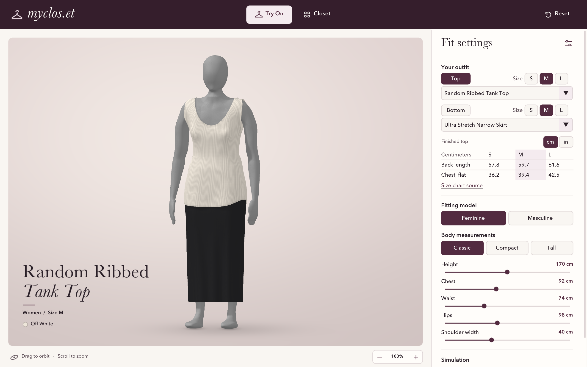
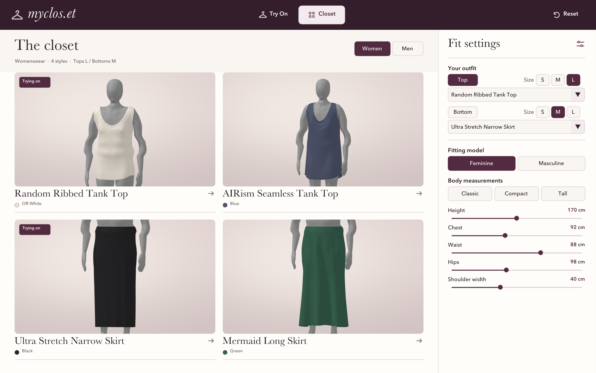

# myclos.et

An interactive 3D virtual try-on project for exploring how clothing sizes drape on adjustable body shapes. This repository contains the [proposal website](index.html) and the native app for the **UC Berkeley CS184 Fall 2026 Final Project**.

A native macOS fitting room built with C++17, OpenGL, GLFW, and Dear ImGui. Combine any of six tops with two skirts or three pairs of pants, or try a piece on its own. Compare S/M/L on either adjustable fitting model and view the finished-garment chart in inches or centimeters. [Size charts and product sources](CATALOG.md)



## Build and launch

Install CMake 3.24 or newer and the Xcode Command Line Tools. The first configure downloads the pinned GLFW 3.4 and Dear ImGui 1.91.9b source archives and verifies their SHA-256 hashes. Subsequent builds use the local copies.

```sh
cmake -S . -B build -DCMAKE_BUILD_TYPE=Release
cmake --build build --parallel
open build/mycloset.app
```

## Source layout

| Location | What lives here |
| --- | --- |
| [src/main.cpp](src/main.cpp) | Command-line options and app startup and shutdown |
| [src/ui/](src/ui/) | Fitting view, closet gallery, outfit picker, and fit controls |
| [src/viewer/](src/viewer/) | Session loop, preview cache, OpenGL renderer, and screenshot replay |
| [src/simulation/](src/simulation/) | Avatar geometry, garment patterns, cloth solver, and contact between the body and garments |
| [tools/bench.cpp](tools/bench.cpp) | Simulation benchmarks and consistency checks |
| [tests/fit_check.cpp](tests/fit_check.cpp) | Geometry checks for garment fit, measurement edits, and layered outfits |
| [tests/form_measurements.cpp](tests/form_measurements.cpp) | Independent tape measurements on the visible body mesh |

## One-minute walkthrough

1. Start with the Off White Random Ribbed Tank Top and Black Ultra Stretch Narrow Skirt. Use the **Top** and **Bottom** pickers in Try On to change either piece, or choose **None** to remove it. Each piece has its own size. Drag the figure to orbit. Scroll over the fitting view or use its − and + buttons to zoom. The inspector shows the selected piece’s measurements for S/M/L and links to the source.
2. Drag Waist from 74 to 88 cm. Watch the same cloth move over the changing body. Select S and then L with the camera held in place.
3. Toggle **Relative stretch** to compare the same 0–30% color scale. Switch on **Wind** and change strength or direction.
4. Open **Closet**, select **Women** or **Men**, and pick a garment. It replaces the matching top or bottom and keeps the other piece on the model. The men’s collection includes two tanks, a regular crew neck, an oversized tee, ankle pants, wide tapered pants, and cargo joggers. Change **Fitting model** independently of the collection. Reopening the same collection reuses its previews. **Reset** returns to the opening scene.



[Men’s closet](evidence/mens-closet.png) · [DRY-EX tee with Smart Ankle Pants](evidence/mens-try-on.png) · [Oversized tee with Wide Tapered Pants](evidence/oversized-outfit.png)

The fit comparison shows four outfits in M, then holds the masculine Classic form, trousers and camera fixed while the oversized tee changes from S to M to L. [Compare the cuts and sizes](evidence/fit-and-sizing.jpg)

Tab and Shift-Tab move keyboard focus. Space activates focused buttons. Use arrow keys on focused sliders. With the scene focused, A/D rotate the view and W/S adjust zoom.

## Verification and replay

Run from the implementation directory. The capture command renders the actual app through a hidden OpenGL window and writes thirteen PNGs to the chosen directory. It replays the body change, orbit, size switch, stretch and wind, the women's closet, the selected skirt, its cached previews, the men's closet and fitting, removing each layer, and three tee-and-trouser combinations. The capture and benchmark commands replace their named output files.

```sh
ctest --test-dir build --output-on-failure
build/mycloset_bench evidence/benchmark.csv
build/mycloset_form_check > evidence/form-measurements.csv
build/mycloset_fit_check --all > evidence/fit-check.csv
build/mycloset_fit_check --edits > evidence/fit-edits.csv
build/mycloset_fit_check --outfits > evidence/outfit-check.csv
build/mycloset.app/Contents/MacOS/mycloset --capture evidence
```

The fit report records the three medium outfits on each of the six fitting presets. It writes one CSV row per garment layer and captures front, side, and back views of the same simulated state with wind off.

```sh
mkdir -p build/fit-run
build/mycloset.app/Contents/MacOS/mycloset --fit-report build/fit-run > build/fit-run/fit-report.csv
```

Use `--hero-report` with a separate output directory for the four reference outfits. It captures the men's DRY-EX tank with Narrow Skirt, the DRY-EX tee, the Ribbed Tank with Mermaid Skirt, and the AIRism Seamless Tank on the Tall feminine preset.

The body tape measures the convex circumference of a horizontal mesh section and excludes the arms. High hip is midway between the waist and hip tape heights. The hem and chest measurements follow the cloth's actual edge and chest row. Shoulder gap is the maximum vertical clearance at the garment's supports. Minimum cloth clearance measures cloth vertices against body triangles. `nan` marks a measurement that does not apply or has no body section at that height. The mesh intersection tests also check cloth triangles between vertices.

The report includes the high-point shoulder to hem tape on the rest pattern and the draped top. Layered settling is measured after both garments and their mutual contact are resolved. The Mermaid waistband height is measured against the body's waist tape level.

### Fit parameters

- Set the tank strap widths and neckline depths, the AIRism hem rise, and the Mermaid flare and gathers in [`draftPanels`](src/simulation/pattern.cpp). The Mermaid skirt widens below the hip.
- Set sleeve ease and jogger rise, taper, and cuff gathers in [`limb_patterns.cpp`](src/simulation/limb_patterns.cpp).
- Set lateral stretch and waistband strain limits in the spring setup in [`pattern.cpp`](src/simulation/pattern.cpp). Set damping and shoulder support release in [`cloth.cpp`](src/simulation/cloth.cpp).
- Keep the rest measurements in the [UNIQLO catalog](CATALOG.md). Fitting the waistband changes the worn circumference at the measured waist.

The CPU runner can also be built independently.

```sh
cmake -S . -B build-headless -DBUILD_VIEWER=OFF -DCMAKE_BUILD_TYPE=Release
cmake --build build-headless --parallel
ctest --test-dir build-headless --output-on-failure
build-headless/mycloset_bench build-headless/benchmark.csv
```

## What runs

- Both fitting figures stand in a symmetrical A-pose with level shoulders and hips. The viewer renders the full HM08 body and the solver builds its collision field from a lower-resolution proxy. It fits the side panels into the space between the arm and torso and seats the straps on the shoulders. Body and cloth cast shadows on one another as the figure rotates. Measurement edits carry the cloth and its velocity onto the changed body. [Fitting models](assets/AVATAR.md)
- Two garment panels share side-seam particles. The tank openings, strap widths and hem curves follow the individual styles. The bust ring measures twice the published flat chest width. Skirts use the published waist, hip and length. The T-shirts have sleeves sewn into both armholes. Dropped shoulders consume part of the published center-back-to-cuff length. Top lengths follow the fabric surface from back collar to hem. Trousers split at a shared crotch and each inside leg seam uses the published inseam. The straight ankle trousers have a pressed leg crease, the wide trousers carry more width through the knee, and the joggers gather above their cuffs. Tests check all 33 patterns against the product charts.
- The CPU solver advances at 120 Hz. Hooke springs apply structural, shear, and bending forces to equal-mass particles. Damped Verlet integration is followed by five strain-limiting and body-contact passes. Tension-only constraints carry the fabric’s weight to its supports. The solver resolves contact at garment vertices, along edges, and at triangle centers. Friction damps fabric sliding on the mannequin. A spatial hash handles particle self-contact. Wind pressure depends on triangle orientation and varies with deterministic time-based gusts.
- The heatmap averages positive relative elongation on incident surface edges. It represents simulated strain. Point-contact approximations and attachment choices affect the readings, especially near straps and waistbands. Large deformations can still produce triangle intersections.
- When two pieces are worn, the top hangs outside the waistband. Contact around the waist and hips uses the current draped skirt or trousers, and cloth near the arms is constrained by the fitted figure. The two garments keep separate sizes and simulation histories.
- A background worker drapes the selected collection. OpenGL renders thumbnails on the main thread and refreshes them when the fitting model changes. The in-memory entries are scoped to the fitting model, five measurements, and garment size. Each entry retains cloth positions and Verlet history. The store checks the configuration again before accepting a completed background job.

## Read the experiment

The CSVs in `evidence/` describe the original prototype. Use the fit report command to capture the current measurements and renders.

[benchmark.csv](evidence/benchmark.csv) contains the Random Ribbed Tank Top on Classic, Compact, and Tall bodies (indices 0–2) in S/M/L, and a waist-edit time series within the Classic/M run. The waist moves from 74 to 90 cm over one simulated second and holds for another second. Each series sample covers ten steps. The simulator uses no random generator for these cases.

Static cases settle when RMS vertex speed stays below 1 cm/s for 60 consecutive steps, with a six-second simulated-time cap. The CSV labels timeouts, reports mean wall-clock milliseconds per solver step, and records the nearest-rank p95 of vertex stretch. The regional p95 restricts this measure to cloth vertices between 55% and 74% of the current stature, excluding the shoulder attachments. To inspect a deliberately tight fit, use Tall with chest 112, waist 100, hips 120, and size S. Compare with L from the same view. The penetration columns measure remaining cloth vertices inside the collision field after projection, with a 0.01 mm reporting tolerance.

Independent measurements on the visible masculine Classic form give a 98.93 cm chest, 82.02 cm waist and 98.33 cm seat against settings of 99, 82 and 98 cm. On that form, the medium oversized tee is approximately 5 cm wider across the front at the chest than the regular medium tee. The medium wide trouser leg is about 18.3 cm across at knee height, compared with 14.8 cm for the ankle trouser. [Measured forms](evidence/form-measurements.csv) · [Silhouette and chart checks](tools/bench.cpp)

The independent fit check intersects garment triangles with the physical body mesh and checks for enclosed garment vertices. The archived prototype cleared 198 static fits across eleven styles in S/M/L on three presets for each model. Of these, 193 settled within six simulated seconds and five reached the time cap. All 230 archived frames sampled during measurement edits and wind also cleared the body. [Earlier fit comparison](evidence/fit-comparison.jpg) · [Static fits](evidence/fit-check.csv) · [Live measurement edits](evidence/fit-edits.csv)

The outfit check exercises all 30 top–bottom combinations on both figures with independent clothing sizes. It checks both layers against the body and each other after dressing, under wind, and during a waist adjustment. [Outfit results](evidence/outfit-check.csv)

## Starting point

This AI-assisted prototype is the reproducible starting point for the CS184 project. The fitted avatars use MakeHuman core geometry. [Avatar asset credits](assets/AVATAR.md) The garment patterns, solver, application, and benchmark are prototype implementations. Product names, colors, and published dimensions are documented in the catalog. The application uses GLFW for the window and input and Dear ImGui for the controls. HW4 provided the conceptual background for cloth simulation. The team's work can build on this baseline through independent geometry and collision implementations, controlled comparisons, and interpretation of measured results.

[CS184 project requirements](https://cs184.eecs.berkeley.edu/fa26/project/) · [Course cloth material](https://cs184.eecs.berkeley.edu/fa26/hw/hw4/) · [GLFW](https://www.glfw.org/) · [Dear ImGui](https://github.com/ocornut/imgui)
